# Backend Ledger: Bank Transaction System

A REST API for banking-style money transfers built on a **double-entry ledger**. Account balances are never stored. They are calculated from immutable credit and debit entries using a MongoDB aggregation pipeline, and every transfer is protected by **idempotency keys** and a **MongoDB transaction** so money is either fully moved or not moved at all.


**Live API:** https://bank-transaction-system-4qad.onrender.com
**Repository:** https://github.com/Koushikk07/Bank-Transaction-System

> The live instance runs on Render's free tier. After a period of inactivity it spins down, so the **first request can take 50 seconds or more**. Open the link once and wait before testing.

---

## Table of contents

1. [Overview](#overview)
2. [Features](#features)
3. [Tech stack](#tech-stack)
4. [Architecture](#architecture)
5. [Data model](#data-model)
6. [How a transfer works](#how-a-transfer-works)
7. [Balance calculation with aggregation](#balance-calculation-with-aggregation)
8. [API reference](#api-reference)
9. [Screenshots](#screenshots)
10. [Security and validation](#security-and-validation)
11. [Project structure](#project-structure)
12. [Getting started](#getting-started)
13. [Deployment](#deployment)
14. [Testing](#testing)
15. [Design decisions](#design-decisions)
16. [Known limitations](#known-limitations)
17. [Roadmap](#roadmap)
18. [What I added and learned](#what-i-added-and-learned)
19. [Acknowledgements](#acknowledgements)
20. [Author](#author)

---

## Overview

Most beginner banking projects keep a `balance` field on the account and update it on every transfer. That design breaks easily: a crash between two updates can lose money, retries can double-charge, and there is no history of how a balance came to be.

This project takes the approach real financial systems use:

- Every movement of money is recorded as **two ledger entries**: a `DEBIT` on the sender and a `CREDIT` on the receiver.
- Ledger entries are **append-only**. They cannot be updated or deleted.
- An account's **balance is derived** by summing its credits and debits.
- A transfer writes the transaction record and both ledger entries inside **one database transaction**.
- Clients send an **idempotency key** with every transfer, so a retried request never moves money twice.

The result is an auditable, safe-by-design backend that I built to learn how data integrity is handled in money-moving systems.

---

## Features

**Authentication and sessions**
- Register and login with email and password (passwords hashed with bcrypt)
- JWT authentication, accepted from either a cookie or an `Authorization: Bearer` header
- Logout with a **token blacklist**; blacklisted tokens are rejected immediately and removed automatically after 3 days by a MongoDB TTL index
- Role separation: a special **system user** (not creatable through the API) is the only one allowed to issue initial funds

**Accounts**
- A user can own multiple accounts (default currency `INR`)
- Account status: `ACTIVE`, `FROZEN` or `CLOSED`; only `ACTIVE` accounts can send or receive
- List your own accounts and check the balance of any account you own

**Transactions**
- User-to-user transfers with a full validation pipeline
- Idempotent requests through a unique `idempotencyKey`
- Atomic writes using a MongoDB session (all-or-nothing)
- Insufficient-balance protection
- Ownership enforcement: you can only send money from your own accounts

**Ledger**
- Double-entry bookkeeping with `DEBIT` and `CREDIT` entries
- Immutable ledger entries, enforced with `immutable` fields and Mongoose pre-hooks that block updates and deletes
- Balance calculated on demand with an aggregation pipeline

**Notifications**
- Registration and transfer emails sent with Nodemailer (Gmail OAuth2)

---

## Tech stack

| Layer | Technology |
|---|---|
| Runtime | Node.js |
| Framework | Express 5 |
| Database | MongoDB Atlas (replica set, required for transactions) |
| ODM | Mongoose 9 |
| Authentication | JSON Web Tokens, bcryptjs, cookie-parser |
| Email | Nodemailer with Gmail OAuth2 |
| API testing | Postman |
| Hosting | Render (API) and MongoDB Atlas (database) |

---

## Architecture

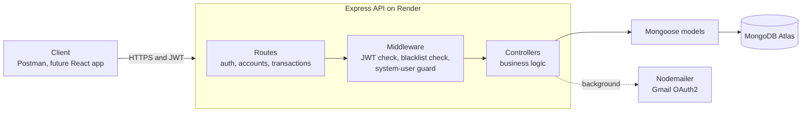

**Request lifecycle:** a request enters a route, passes through the auth middleware (token present, not blacklisted, signature valid, user exists), reaches a controller that applies the business rules, and reads or writes data through Mongoose models. Emails are sent after the database work is done.

---

## Data model

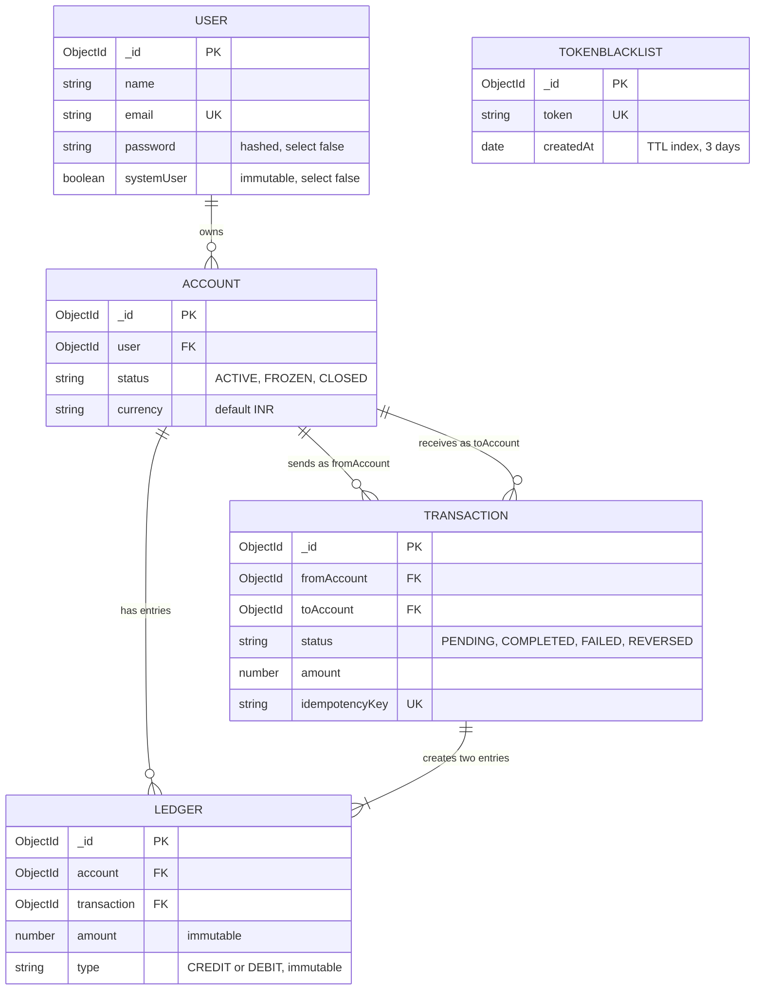

| Collection | Purpose | Notable details |
|---|---|---|
| `users` | Registered people | Unique lowercase email, regex email validation, password minimum 6 characters, `password` and `systemUser` hidden from queries by default |
| `accounts` | Bank accounts | Indexed on `user`, compound index on `user + status`, has the `getBalance()` method |
| `transactions` | One record per transfer | Unique index on `idempotencyKey`, amount cannot be negative |
| `ledgers` | Credit and debit entries | Every field immutable; update and delete operations throw an error |
| `tokenblacklists` | Logged-out tokens | TTL index removes entries after 3 days |

---

## How a transfer works

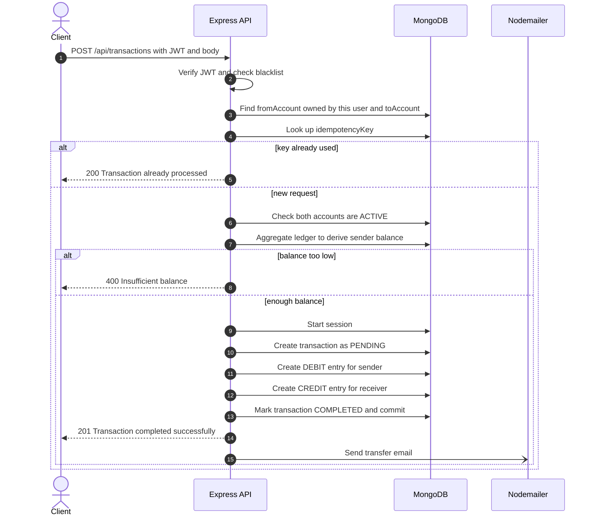

**Step by step**

1. **Authenticate.** The middleware reads the token from the cookie or the `Authorization` header, rejects blacklisted tokens, verifies the signature and loads the user.
2. **Validate the request.** The body must contain `fromAccount`, `toAccount`, `amount` and `idempotencyKey`.
3. **Check ownership.** The `fromAccount` must exist and belong to the logged-in user. Both accounts must exist.
4. **Check idempotency.** If the key was already used, the stored result is returned and nothing is processed again (`COMPLETED` returns the transaction, `PENDING` reports it is still processing, `FAILED` or `REVERSED` explain the outcome).
5. **Check account status.** Both accounts must be `ACTIVE`.
6. **Derive the balance.** The sender's balance is calculated from the ledger with an aggregation pipeline. If it is lower than the amount, the request is rejected.
7. **Write atomically.** Inside one MongoDB session: create the transaction as `PENDING`, create the `DEBIT` and `CREDIT` ledger entries, mark the transaction `COMPLETED` and commit. If any step fails, the whole session is rolled back.
8. **Notify.** A confirmation email is sent to the sender.

**Initial funds:** new accounts start at zero. The **system user** can fund any account through `POST /api/transactions/system/initial-funds`. The same double-entry rules apply, with the system account as the source. The system account's balance is therefore **negative by design**; it represents the total money issued into the system.

---

## Balance calculation with aggregation

There is no `balance` field anywhere in the database. The `getBalance()` method on the account schema sums the ledger:

```js
accountSchema.methods.getBalance = async function () {
  const data = await ledgerModel.aggregate([
    { $match: { account: this._id } },
    {
      $group: {
        _id: null,
        totalDebit: {
          $sum: { $cond: [{ $eq: ["$type", "DEBIT"] }, "$amount", 0] },
        },
        totalCredit: {
          $sum: { $cond: [{ $eq: ["$type", "CREDIT"] }, "$amount", 0] },
        },
      },
    },
  ]);

  if (data.length === 0) return 0;
  return data[0].totalCredit - data[0].totalDebit;
};
```

- `$match` keeps only the entries that belong to the account.
- `$group` collapses them into one document, using `$cond` to add up debits and credits separately in a single pass.
- Balance is `totalCredit - totalDebit`. An account with no entries has a balance of `0`.

Because entries are immutable and the balance is always recomputed, the balance cannot drift out of sync with the history.

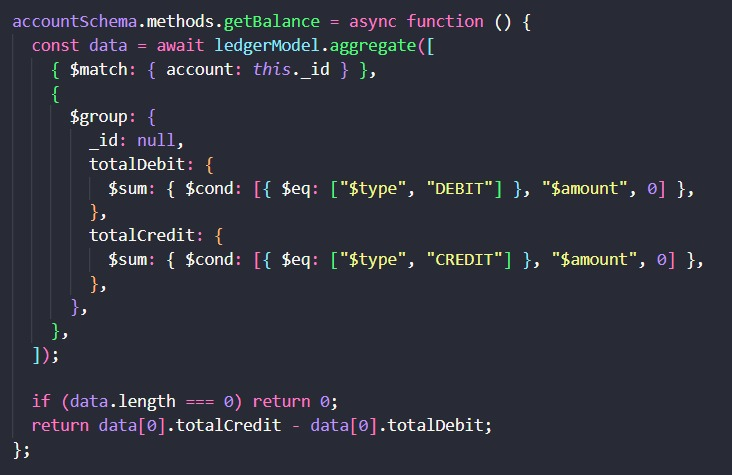

---

## API reference

**Base URL:** `https://bank-transaction-system-4qad.onrender.com` (or `http://localhost:3000` locally)

Protected routes need a valid token, sent either as the `token` cookie or as `Authorization: Bearer <token>`.

| Method | Endpoint | Auth | Description | Success |
|---|---|---|---|---|
| GET | `/` | None | Health check | 200 |
| POST | `/api/auth/register` | None | Create a user | 201 |
| POST | `/api/auth/login` | None | Log in and receive a token | 200 |
| POST | `/api/auth/logout` | User | Blacklist the current token | 200 |
| POST | `/api/accounts` | User | Create an account for the logged-in user | 201 |
| GET | `/api/accounts` | User | List the logged-in user's accounts | 200 |
| GET | `/api/accounts/balance/:accountId` | User | Get the balance of an account you own | 200 |
| POST | `/api/transactions` | User | Transfer money between accounts | 201 |
| POST | `/api/transactions/system/initial-funds` | System user | Fund an account from the system account | 201 |

### Register

`POST /api/auth/register`

```json
{ "name": "Alice", "email": "alice@example.com", "password": "secret123" }
```

Response `201`:

```json
{
  "user": { "_id": "...", "email": "alice@example.com", "name": "Alice" },
  "token": "<JWT>"
}
```

Returns `422` if the email is already registered. A welcome email is sent in the background.

### Login

`POST /api/auth/login` with `{ "email", "password" }`. Returns `200` with the same `user` and `token` shape, and also sets the `token` cookie. The token is valid for 3 days.

### Logout

`POST /api/auth/logout`. The token is added to the blacklist, and any later request with it returns `401 Token is Blacklisted!`.

### Create and list accounts

`POST /api/accounts` needs no body and returns `201` with `{ "account": { ... } }`.
`GET /api/accounts` returns `200` with `{ "accounts": [ ... ] }`.

### Get balance

`GET /api/accounts/balance/:accountId`

```json
{ "accountId": "6ae8a7eebb25357f7299f7f6", "balance": 25000 }
```

Returns `404 Account not found` if the account does not exist **or belongs to someone else**.

### Transfer money

`POST /api/transactions`

```json
{
  "fromAccount": "<your account id>",
  "toAccount": "<receiver account id>",
  "amount": 1500,
  "idempotencyKey": "any-unique-string-per-transfer"
}
```

| Case | Response |
|---|---|
| Success | `201` with `Transaction completed successfully` and the transaction |
| Same `idempotencyKey` sent again | `200` with `Transaction already processed` and the original transaction |
| Balance too low | `400` with `Insufficient balance. Current balance is X. Requested amount is Y` |
| `fromAccount` is not yours, or an account is invalid | Rejected with `Invalid fromAccount or toAccount` |
| Missing or invalid token | `401` |

### Initial funds (system user only)

`POST /api/transactions/system/initial-funds`

```json
{ "toAccount": "<account id>", "amount": 25000, "idempotencyKey": "unique-key" }
```

Returns `201` with `Initial funds transaction completed successfully`. A normal user calling this route gets `403 Forbidden access, not a system user`.

### Try it with curl

```bash
BASE_URL=https://bank-transaction-system-4qad.onrender.com

# 1. Register and log in
curl -X POST $BASE_URL/api/auth/register -H "Content-Type: application/json" \
  -d '{"name":"Alice","email":"alice@example.com","password":"secret123"}'

curl -X POST $BASE_URL/api/auth/login -H "Content-Type: application/json" \
  -d '{"email":"alice@example.com","password":"secret123"}'

# 2. Create an account (use the token from login)
curl -X POST $BASE_URL/api/accounts -H "Authorization: Bearer <TOKEN>"

# 3. Check the balance
curl $BASE_URL/api/accounts/balance/<ACCOUNT_ID> -H "Authorization: Bearer <TOKEN>"

# 4. Transfer
curl -X POST $BASE_URL/api/transactions \
  -H "Authorization: Bearer <TOKEN>" -H "Content-Type: application/json" \
  -d '{"fromAccount":"<FROM_ID>","toAccount":"<TO_ID>","amount":500,"idempotencyKey":"demo-001"}'
```

A new account starts with a balance of 0, so a system user must fund it first (see [Getting started](#getting-started)).

---

## Screenshots

All screenshots are from the deployed API.

### Deployment

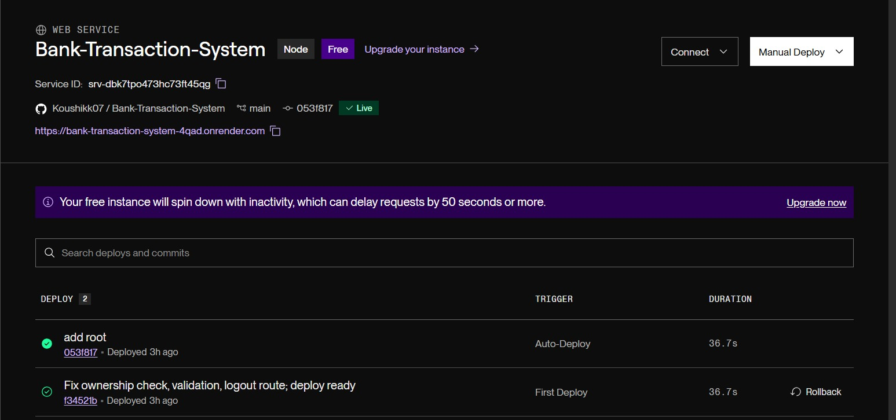
*The service is live on Render, auto-deploying from the `main` branch.*

### Funding an account (system user)

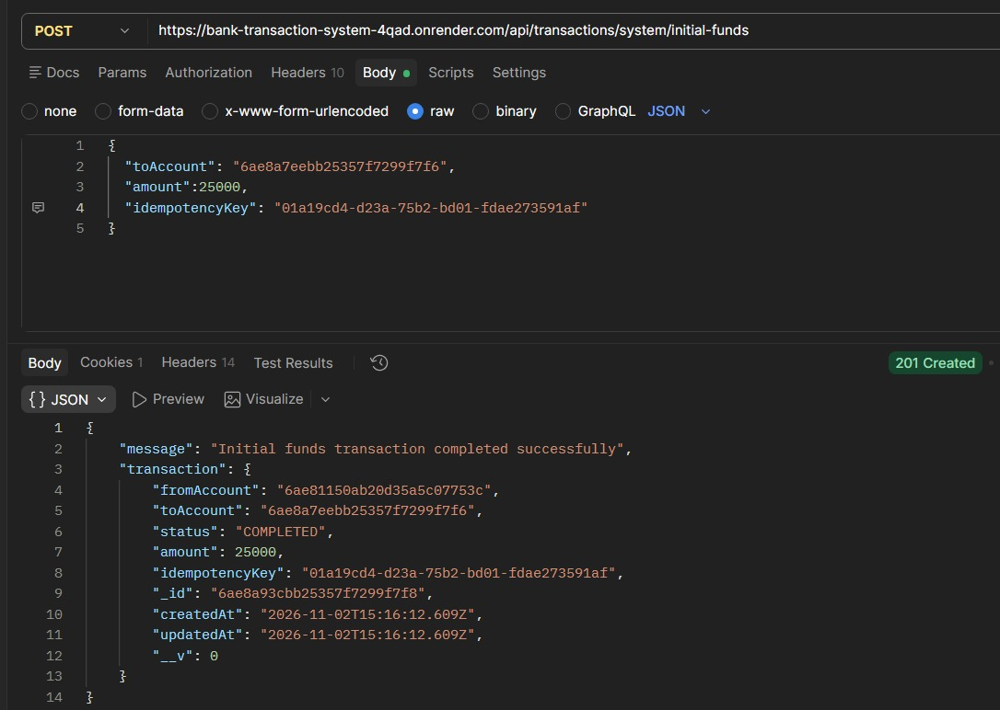
*The system user credits an account with 25,000. The response shows the system account as the source.*

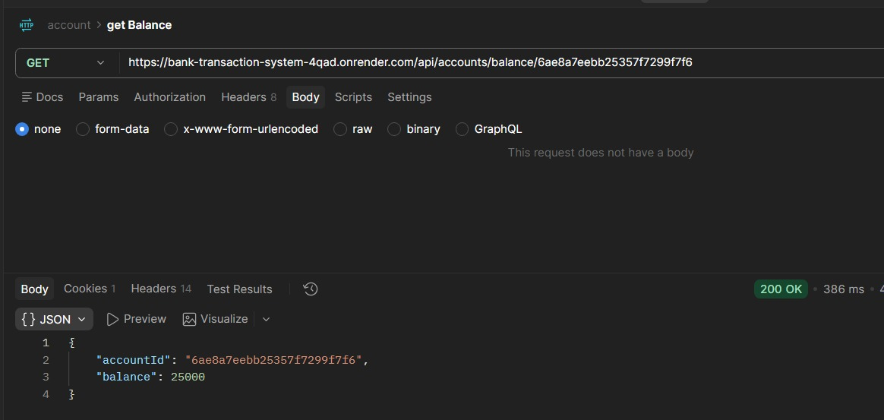
*The derived balance for the funded account is 25,000.*

### Money transfer

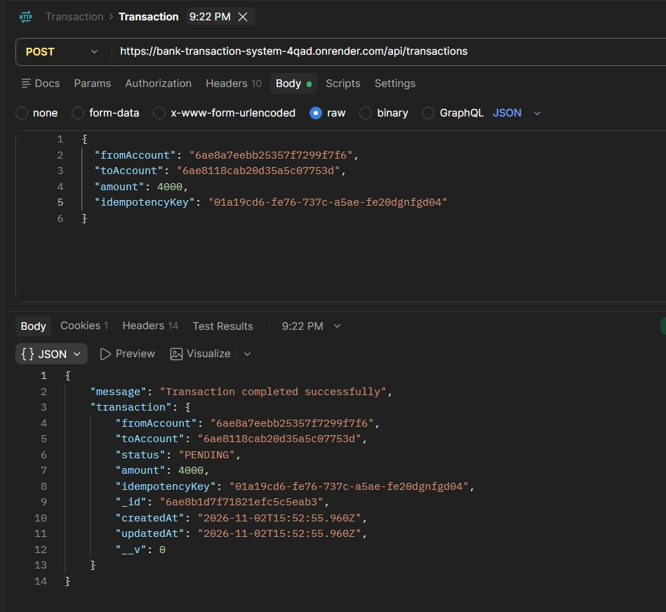
*A successful transfer between two accounts.*

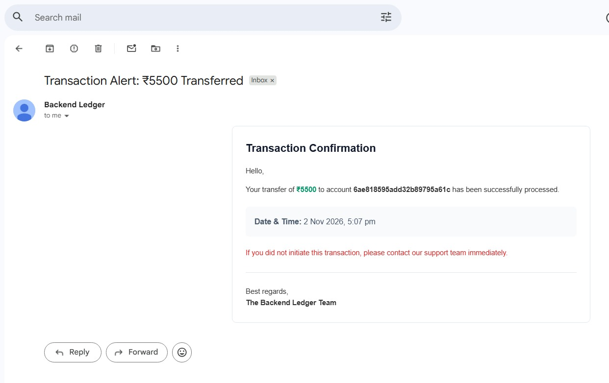
*The confirmation email sent through Nodemailer (verified in a local run).*

### Ledger in MongoDB

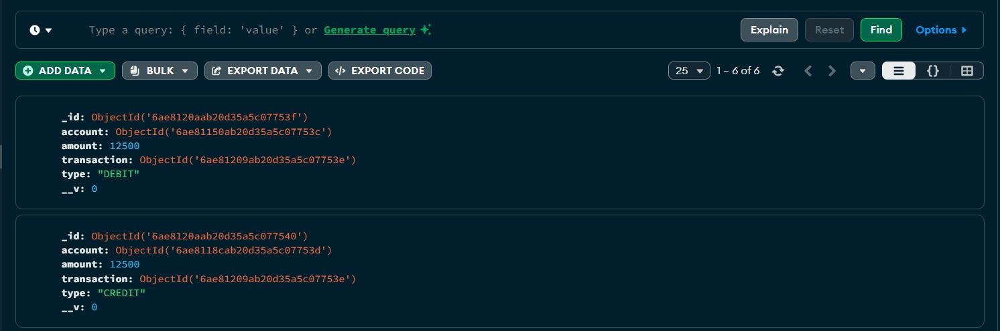
*One transfer creates two ledger entries with the same `transaction` id: a `DEBIT` on the sender and a `CREDIT` on the receiver.*

### Safety checks

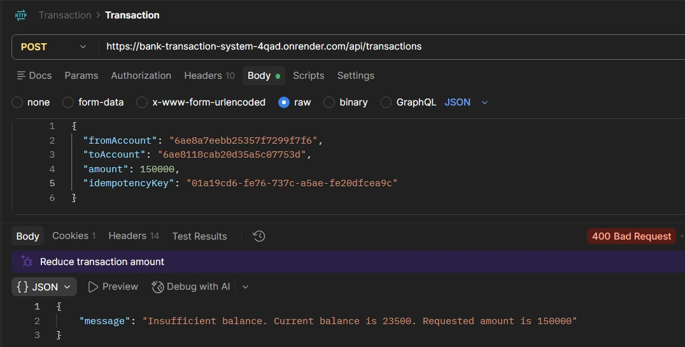
*Transfers above the available balance are rejected with the current balance in the message.*

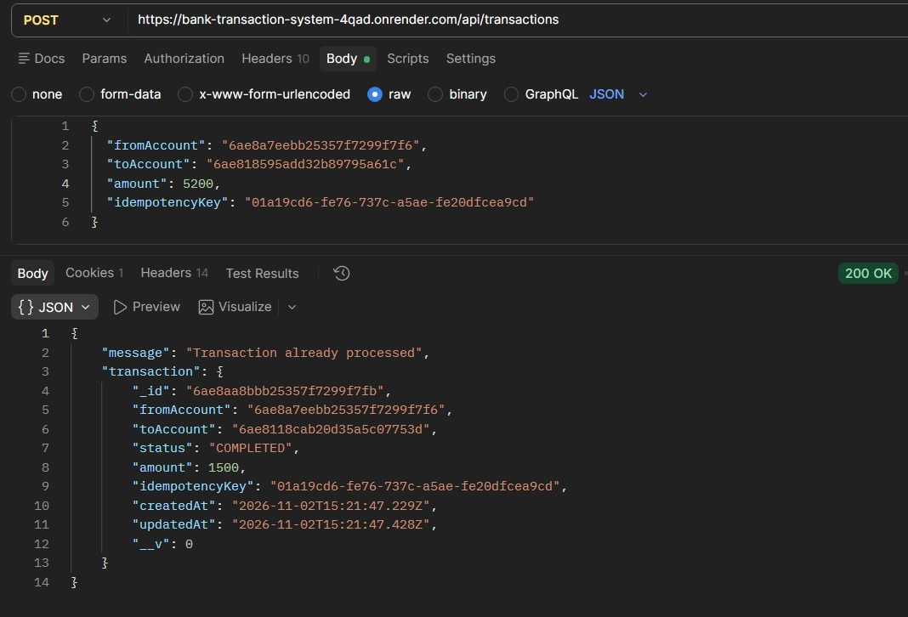
*Reusing an `idempotencyKey` returns the original transaction and moves no money.*

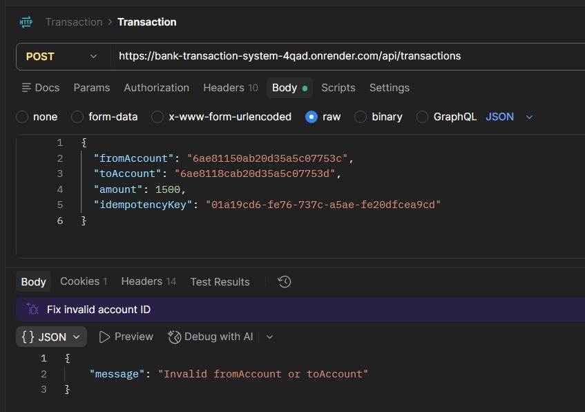
*Trying to send from an account that does not belong to the logged-in user is rejected.*

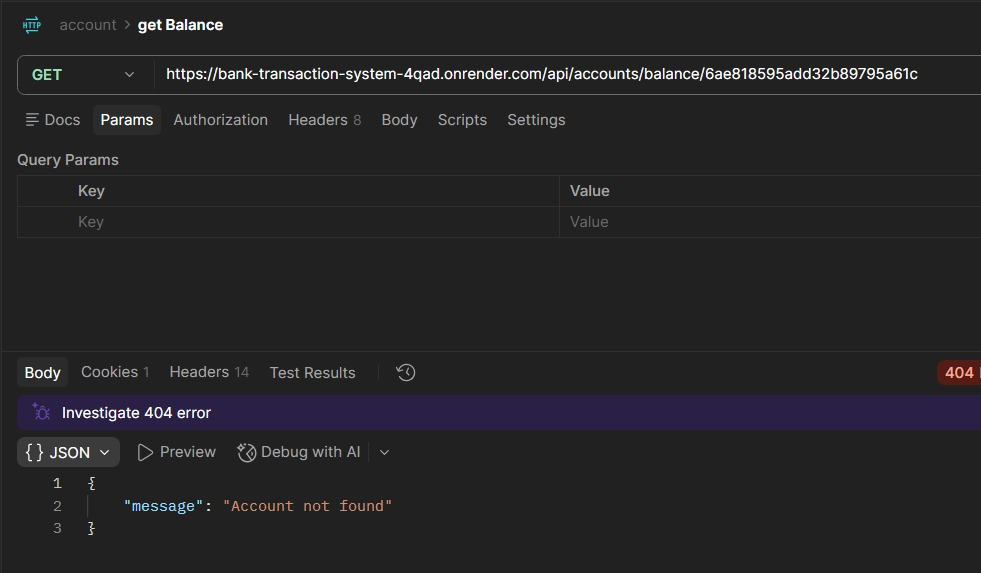
*Checking the balance of an account you do not own returns `Account not found`.*

---

## Security and validation

| Concern | How it is handled |
|---|---|
| Password storage | Hashed with bcrypt (10 rounds) in a pre-save hook; the field is excluded from queries by default |
| Authentication | JWT signed with `JWT_SECRET`, expires in 3 days |
| Logout | Token stored in a blacklist collection; checked on every protected request; TTL index cleans it up |
| Privilege separation | `systemUser` is immutable, hidden by default and cannot be set through registration; a separate middleware guards system routes |
| Authorization | Transfers must originate from an account owned by the caller; balance lookups only return accounts you own |
| Duplicate requests | Unique index on `idempotencyKey` plus an explicit lookup before processing |
| Data integrity | Transaction record and both ledger entries are written in a single MongoDB session |
| Ledger tampering | Immutable fields and pre-hooks on every update and delete operation |
| Input validation | Required-field checks, email regex, password minimum length, schema-level `min: 0` on amounts, account status checks, balance checks |
| Secrets | Loaded from environment variables; `.env` is git-ignored |

---

## Project structure

```
Bank-Transaction-System/
├── server.js                      # Entry point: connects to the database, starts the server
├── package.json
├── .env.example                   # Names of required environment variables
├── docs/
│   └── screenshots/               # Images used in this README
├── postman/
│   └── backend-ledger.postman_collection.json
├── scripts/
│   └── createSystemUser.js        # One-time script to create the system user
└── src/
    ├── app.js                     # Express app, middleware and route mounting
    ├── config/
    │   └── db.js                  # MongoDB connection
    ├── controllers/
    │   ├── auth.controller.js     # Register, login, logout
    │   ├── account.controller.js  # Create, list, balance
    │   └── transaction.controller.js  # Transfers and initial funds
    ├── middleware/
    │   └── auth.middleware.js     # authMiddleware and authSystemMiddleware
    ├── models/
    │   ├── user.model.js
    │   ├── account.model.js       # Includes getBalance() aggregation
    │   ├── transaction.model.js
    │   ├── ledger.model.js        # Immutable entries
    │   └── blacklist.model.js     # TTL-indexed token blacklist
    ├── routes/
    │   ├── auth.routes.js
    │   ├── account.routes.js
    │   └── transaction.routes.js
    └── services/
        └── email.service.js       # Nodemailer with Gmail OAuth2
```

---

## Getting started

### Prerequisites

- Node.js 20 or later
- A MongoDB **Atlas** cluster (the free M0 tier works). MongoDB transactions need a replica set, and a plain standalone local MongoDB will fail with a "Transaction numbers are only allowed on a replica set member" error.
- A Google Cloud OAuth client and refresh token for Gmail (only needed for emails)
- Postman or curl for testing

### 1. Clone and install

```bash
git clone https://github.com/Koushikk07/Bank-Transaction-System.git
cd Bank-Transaction-System
npm install
```

### 2. Configure environment variables

Copy the example file and fill in your values:

```bash
cp .env.example .env
```

| Variable | Description |
|---|---|
| `MONGO_URI` | Atlas connection string including a database name, for example `mongodb+srv://<user>:<password>@<cluster>.mongodb.net/ledger?retryWrites=true&w=majority` |
| `JWT_SECRET` | A long random string used to sign tokens |
| `EMAIL_USER` | The Gmail address that sends emails |
| `CLIENT_ID` | Google OAuth client ID |
| `CLIENT_SECRET` | Google OAuth client secret |
| `REFRESH_TOKEN` | Google OAuth refresh token for the Gmail account |
| `SYSTEM_USER_PASSWORD` | Password for the one-time system user script |
| `PORT` | Optional. Defaults to 3000 (Render sets this automatically) |

Generate a strong secret with:

```bash
node -e "console.log(require('crypto').randomBytes(48).toString('hex'))"
```

### 3. Create the system user

The system user cannot be created through the API. Run the seed script once:

```bash
node scripts/createSystemUser.js
```

This creates `system@ledger.com` with `systemUser: true`. Log in as that user, create an account for it, and use that account as the source of initial funds.

### 4. Run the server

```bash
npm run dev     # development with nodemon
npm start       # production
```

You should see `Server is running on port: 3000` and a database connection message.

### 5. Fund an account and make a transfer

1. Register two users (Alice and Bob) and log in as each.
2. Each user calls `POST /api/accounts` to create an account.
3. Log in as the system user, create the system account, then call `POST /api/transactions/system/initial-funds` to fund Alice's account.
4. Alice calls `POST /api/transactions` to send money to Bob's account.
5. Check both balances with `GET /api/accounts/balance/:accountId`.

---

## Deployment

The API is deployed on **Render** and the database on **MongoDB Atlas**.

**Atlas**
- Create a free M0 cluster and a database user
- Network Access: allow `0.0.0.0/0` (Render's outbound IPs change)
- Use the connection string with a database name in `MONGO_URI`

**Render**
- New Web Service connected to the GitHub repository, branch `main`
- Build command: `npm install`
- Start command: `npm start`
- Environment variables: all values from the table above
- Auto-deploy is on, so every push to `main` redeploys

**Free-tier notes**
- The instance spins down after inactivity, so the first request can take 50 seconds or more.
- Render's free tier blocks outbound SMTP ports (25, 465 and 587), so **email delivery may not work from the hosted demo**. Emails were verified in local runs. Emails are sent in the background, so a failed email never affects a transfer.

---

## Testing

### Postman collection

A Postman collection is included in [`postman/`](postman/). Import it, set the `baseUrl` variable to the live URL or `http://localhost:3000`, and run the requests in order.

> **Postman tip:** the middleware reads the `token` cookie before the `Authorization` header. When switching between users, delete the saved cookie in Postman first, or you will keep acting as the previous user.

### Manual test checklist

| # | Scenario | Expected result |
|---|---|---|
| 1 | Register a new user | `201` with user and token |
| 2 | Register the same email again | `422` user already exists |
| 3 | Create an account | `201` with the account |
| 4 | Fund an account as the system user | `201` initial funds completed |
| 5 | Normal user calls initial funds | `403` not a system user |
| 6 | Get balance after funding | Balance equals the funded amount |
| 7 | Transfer with enough balance | `201`, both balances change, ledger has a DEBIT and a CREDIT |
| 8 | Transfer more than the balance | `400` insufficient balance |
| 9 | Send the same transfer twice with the same key | Second call returns `200` already processed, balances unchanged |
| 10 | Transfer from another user's account | Rejected, no ledger entries created |
| 11 | Get balance of another user's account | `404` account not found |
| 12 | Call a protected route without a token | `401` |
| 13 | Log out, then reuse the token | `401` token is blacklisted |

---

## Design decisions

**Why derive the balance instead of storing it?**
A stored balance can drift out of sync if a write fails halfway, and it carries no history. Summing immutable ledger entries gives a single source of truth and a complete audit trail. The trade-off is that balance reads cost an aggregation, which is acceptable here and can be optimised later with indexes or periodic snapshots.

**Why immutable ledger entries?**
In accounting, mistakes are fixed by adding a new correcting entry, never by editing history. The `immutable` schema options and the pre-hooks make that rule part of the code.

**Why idempotency keys?**
Networks fail and clients retry. Without a key, a retry after a timeout could charge the sender twice. The unique index on `idempotencyKey` makes duplicates impossible even if two identical requests arrive together.

**Why a MongoDB session?**
A transfer touches three documents (the transaction and two ledger entries). The session makes them succeed or fail together, so the ledger can never contain a debit without its matching credit.

**Why a system user?**
Money must come from somewhere. Funding accounts from a dedicated system account keeps the ledger balanced, since every credit has a matching debit, and keeps issuing money a privileged operation.

**Why a token blacklist for JWT logout?**
JWTs are stateless, so a logged-out token would otherwise stay valid until it expires. The blacklist closes that gap, and a TTL index keeps the collection small by deleting entries once they could no longer be valid.

---

## Known limitations

These are known gaps I plan to address:

- **No automated tests yet.** Verification is manual through Postman.
- **Concurrency edge case.** The balance check happens before the database session starts, so two simultaneous transfers from the same account could both pass the check. The fix is to do the check inside the session and force a write conflict.
- **Idempotency payload mismatch.** Reusing a key with a different amount or receiver returns the original transaction instead of an error. Stricter systems reject this as a conflict.
- **No transaction history endpoint,** pagination or search yet.
- **No rate limiting or refresh tokens.**
- **Cookie flags.** The token cookie does not yet set `httpOnly`, `secure` and `sameSite`.
- **Emails on the hosted demo** may not send because of Render's free-tier SMTP block.
- **No frontend.** The API is exercised through Postman and curl.

---

## Roadmap

- [ ] Transaction history and monthly summary endpoints using aggregation, with pagination
- [ ] Concurrency-safe balance check inside the session
- [ ] Reject idempotency key reuse with a different payload
- [ ] Request validation with Zod or express-validator
- [ ] Rate limiting and refresh tokens
- [ ] Automated tests with Jest and Supertest
- [ ] Swagger / OpenAPI documentation
- [ ] React + TypeScript frontend
- [ ] Switch email delivery to an HTTPS-based provider so it works on free hosting

---

## What I added and learned

I built the base of this project by following a Backend Ledger tutorial, then extended and hardened it:

- Enforced **account ownership** on transfers, so a user cannot send money from someone else's account
- Wired up the **logout route** and the token blacklist flow end to end
- Added **`PORT` environment support** and a root health route so the app runs on Render
- Tested the API against **success, failure, idempotency and security cases**, and fixed what I found
- Deployed the API to **Render** with the database on **MongoDB Atlas**
- Documented the API, data model and design decisions, and added a Postman collection

**What I learned:** double-entry ledger design, why balances should be derived, idempotent API design, MongoDB transactions and replica-set requirements, TTL indexes, aggregation with `$match`, `$group` and `$cond`, JWT logout strategies, and the difference between authentication and authorization (the ownership bug was a good reminder).

---

## Acknowledgements

The project is based on the **Backend Ledger** tutorial by [Sheryians Coding School](https://www.youtube.com/@sheryians) on YouTube. The core flow (ledger, idempotency, sessions, system user, email notifications) follows that tutorial; the fixes, deployment and documentation listed above are my own additions.

---

## Author

**Gudapur Koushik**

- GitHub: [@Koushikk07](https://github.com/Koushikk07)
- LinkedIn: [linkedin.com/in/gudapurkoushik](https://linkedin.com/in/gudapurkoushik)

If you have feedback or suggestions for the project, feel free to open an issue or reach out.
